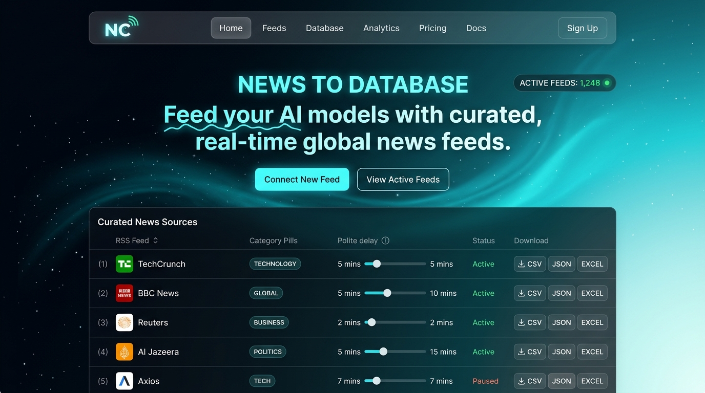

# News Collector & Web Engine

A modern, high-performance news aggregator and intelligence pipeline built entirely in **React 19 + TypeScript + Vite + Tailwind CSS** with a native **Node.js / Express** crawling backend. The application aggregates, normalizes, and categorizes RSS and Atom feeds across curated publisher sources with built-in SSRF protection, host-level throttling, real-time preview filters, and instant in-memory multi-format downloads (CSV, JSON, and Excel).

---

## 🖼️ Front Page & Design Reference



### Front Page Architecture:
1. **Sticky Glass Navbar**:
   - Frosted backdrop blur (`bg-[#030712]/85`) with glowing brand badge.
   - Quick navigation links (`#features`, `#collector`) and instant toggle for the real-time execution log.
2. **Hero Section & Dynamic Canvas Headline**:
   - Live badge with pulsing cyan indicator.
   - Dynamic HTML5 Canvas headline (*"News to Database / Feed your AI models.."*) rendering continuous sine-wave bezier curves clipped directly over typography.
   - Direct call-to-actions scrolling to the collector workspace or jumping to live logs.
3. **Feature Pillars**:
   - Glassmorphic feature cards detailing verified feeds (`feeds.json`), SSRF defense layers, and in-memory multi-format exports.
4. **Interactive Collector Workspace**:
   - **Step 1 — Choose Sites**: Multi-source checklist with feed counter, Select All / Clear, custom site addition modal, and polite delay slider.
   - **Step 2 — Collect Execution**: Physics-based wave pulse loader (`LoaderOne`) with real-time progress indicators.
   - **Step 3 — Preview & Filtering**: Live metrics counters, site health summary, keyword search, date range pickers, and active category tags.
   - **Step 4 — In-Memory Export**: Direct browser downloads for UTF-8 CSV, structured JSON, and auto-column-width Excel files (`.xlsx`).
5. **Execution Log Workspace**:
   - Live streaming terminal log detailing host connections, feed parsing status, throttling intervals, and normalized entry counts.

---

## 🔤 Typography & Font Reference

The web application utilizes Google Fonts linked in the HTML entry point:

| Role | Font Family | Weights | Reference Link |
| :--- | :--- | :--- | :--- |
| **Primary UI & Headings** | **Plus Jakarta Sans** | 400, 500, 600, 700, 800 | [Google Fonts — Plus Jakarta Sans](https://fonts.google.com/specimen/Plus+Jakarta+Sans) |
| **Code, Tables & Terminals** | **JetBrains Mono** | 400, 500 | [Google Fonts — JetBrains Mono](https://fonts.google.com/specimen/JetBrains+Mono) |

---

## 🌌 Color Palette Reference

The front page implements the **32-Step Teal Nebula Starlight Gradient (180°)**:
- **Reference URL**: [Grabient — Teal Nebula Starlight Gradient](https://grabient.com/kYIRS6IRW_bOdPhGITy36g-HuOv8?steps=32&angle=180)
- **Angle**: `180deg` (Linear top-to-bottom)
- **Key Color Stops**:
  - `0%` Deep Midnight Black: `#030712`
  - `16%` Dark Indigo / Deep Ocean: `#0d1d36`
  - `26%` Slate Cyan Navy: `#142f4e`
  - `52%` Ocean Teal: `#146984`
  - `74%` Vivid Cyan: `#23b0b8`
  - `77%` Aqua Marine: `#32bbc1`
  - `87%` Luminous Teal: `#7fdcdd`
  - `100%` Pale Starlight Cyan: `#d9ffff`

---

## 📁 Project Structure

```text
News_Collector/
├── .github/
│   └── workflows/
│       └── deploy.yml               # Automated GitHub Pages CI/CD workflow
├── public/
│   ├── feeds.json                   # Verified publisher RSS/Atom feeds catalog
│   └── front_page_preview.jpg       # Front page design visual reference
├── src/
│   ├── components/
│   │   └── ui/
│   │       ├── canvas-text.tsx      # Canvas-rendered bezier wave headline animation
│   │       └── loader.tsx           # Physics wave pulse loader animation (LoaderOne)
│   ├── lib/
│   │   └── utils.ts                 # Classname merge utility (clsx + twMerge)
│   ├── App.tsx                      # Modern React front page & collector workspace
│   ├── index.css                    # Tailwind CSS v4 & Grabient utility classes
│   └── main.tsx                     # Vite React entry point
├── server.ts                        # Express API server with native TypeScript RSS/Atom crawler
├── package.json                     # Node.js dependencies & build scripts
├── vite.config.ts                   # Vite configuration
├── ARCHITECTURE.md                  # Comprehensive technical architecture documentation
└── README.md                        # Project documentation & reference
```

---

## 🚀 Getting Started

### Prerequisites
- **Node.js 20+** and **npm**

### 1. Install Dependencies
```bash
npm install
```

### 2. Start Development Server
```bash
npm run dev
```
Open [http://localhost:3000](http://localhost:3000) in your browser.

### 3. Production Build
```bash
npm run build
```

---

## 📄 License & Usage

For research and analytical workflows. Respect individual publisher terms of service and RSS syndication rate limits when deploying automated scrapers.
